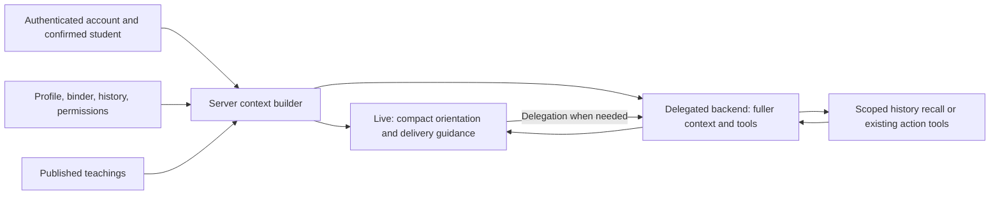

# Making Origen use the information it already has

**Backend review — November 3, 2026**  
**Scope:** Current local working tree plus official API and hosting documentation. This is not a production configuration audit or a claim that all local changes are deployed.  
**Work performed:** Read-only code review, offline checks, and documentation. No application code, production records, sharing permissions, or deployment settings changed for this review.

## Assessment

Origen already has much of the foundation needed for a prepared, personal conversation. It supplies profile information, selects saved conversations and binder content, retrieves older history, includes published teaching guidance, and has guarded mechanisms for coordinator feedback and follow-through.

The main opportunity is **making selection and delivery dependable for the current question**. More stored information, a larger prompt, or another worker will not by itself ensure that the useful detail reaches the answer.

The strongest immediate finding is a mismatch between the guide-refresh request and the server's selectors: the request omits the latest user turn, while the history and teaching selectors can use that turn to choose relevant material. A local probe reproduced the resulting difference in selection inputs. This does not mean the Live service has lost the conversation; it means Origen's own database and teaching lookup may not be searching for the question the student just asked.

My recommendation is to improve this path, make regular student teaching access more question-aware, and measure whether the resulting spoken answers use the evidence. Defer the proposed [Conversation Desk worker](<C:/Users/danie/Documents/ChatGPT/Project Elo-Em/docs/voice-experience/CONVERSATION_DESK_PROPOSAL.md>) until the value of precomputation is demonstrated.

## How information reaches Origen today

The current Live student configuration has two roles:

- **GPT-Live-1 speaks and listens.** Its instructions include conversational behavior, a compact familiar orientation, and selected teaching delivery references.
- **A delegated GPT-6-Luna backend reasons and uses tools.** It receives the fuller server-built context and the tools permitted for the current mode and scope. The local configuration uses low reasoning effort and automatic tool selection.

These are code observations, not a statement that either model is inherently the best possible choice. Older clients and an explicit rollback can still use the Realtime path. See [student Live configuration](<C:/Users/danie/Documents/ChatGPT/Project Elo-Em/server/student-live-session.mjs>) and [voice context construction](<C:/Users/danie/Documents/ChatGPT/Project Elo-Em/server/profile-voice.mjs>).



The implementation is deliberately bounded. It does not hand the complete database to either model.

| Component | What currently happens | Practical implication |
|---|---|---|
| Profile | Server-selected profile fields are supplied, with scope protections. | The caller should not need to repeat an already-known name, stage, or school. |
| Familiar orientation | A compact speech orientation includes relevant profile data, up to three selected known details, and up to two recent summaries when allowed. | Useful for a warm opening, but not a complete answer to every later question. |
| Conversation memory | The backend receives a bounded set of summaries; long summaries are excerpted. | A relevant fact in an omitted middle section may require retrieval. |
| Workspace | Notes and actions are selected using focus, type, status, and recency. | Current selected work is prominent; unrelated or older items may be absent. |
| Historical retrieval | Postgres text search uses English/Spanish configurations and limited synonym expansion, returning a small evidence set. | Efficient and inspectable, but not broad semantic recall. |
| Coordinator guidance | Authorized guidance is loaded and governed by existing feedback and consent mechanisms. | Availability does not imply a student accepted a suggestion. |
| Teaching library | Published teachings are selected for context; tone and conversational approach are represented. | The library is connected. Topic relevance and refresh timing still matter. |
| Preparation cache | A short-lived, revision-aware in-process cache can reuse prepared context. | It is neither a persistent desk nor a guarantee of per-turn retrieval. |

Implementation references: [orientation](<C:/Users/danie/Documents/ChatGPT/Project Elo-Em/server/voice-orientation.mjs>), [workspace selection](<C:/Users/danie/Documents/ChatGPT/Project Elo-Em/server/voice-workspace.mjs>), [historical retrieval](<C:/Users/danie/Documents/ChatGPT/Project Elo-Em/server/history-retrieval.mjs>), [teaching library](<C:/Users/danie/Documents/ChatGPT/Project Elo-Em/server/teaching-library.mjs>), and [preparation cache](<C:/Users/danie/Documents/ChatGPT/Project Elo-Em/server/voice-preparation.mjs>).

## Findings and their limits

### 1. Guide refresh is missing an input its selectors expect

**Observed:** `resources.current.switchGuide` posts an `update-guide` request with scope, profile, workspace focus, and saved memory, but without current `continuity`. Both `voiceHistoryQuery` and `teachingSituationQuery` can use the most recent user turn from that field. A same-guide request without a scope or focus change can also return early.

**Reproduced with fictional input:** For a refresh in Applications, the user sentence “I feel like I have nothing special to write about in my PIQ” produced the following selector inputs:

| Refresh input | History query | Situation text for teaching selection |
|---|---|---|
| Current request shape, without latest turn | Broad application/essay/deadline terms in English and Spanish | Empty |
| Same input with the user turn included | The student's PIQ concern | The student's PIQ concern |

An empty situation query does not prove that no teaching is returned: topic-based selection still exists. It does reduce the selector's ability to distinguish an emotional concern from a procedural question about applications.

**Proposed:** Include the latest completed, independently captured user turn in authorized refresh selection. Preserve intentional clicked-note focus; do not let an unrelated previous sentence override a binder item the student explicitly chose. Reject superseded turns and scope changes.

Evidence: [frontend guide refresh](<C:/Users/danie/Documents/ChatGPT/Project Elo-Em/src/ProfileVoice.tsx:457>), [history selector](<C:/Users/danie/Documents/ChatGPT/Project Elo-Em/server/history-retrieval.mjs:117>), [teaching selector](<C:/Users/danie/Documents/ChatGPT/Project Elo-Em/server/teaching-library.mjs:85>).

### 2. Having a recall tool does not ensure it runs when needed

**Observed:** The regular session exposes `recall_student_context` when live memory and scope permissions allow it. Its instructions tell the model to search when a needed detail is missing. Tool selection is automatic. Registering a completed transcript turn establishes evidence for guarded actions; that registration is not itself a history search.

**Risk:** A model may answer from its current brief, ask a repeated question, or make a broad suggestion without recalling an older relevant constraint. This is a design risk, not a measured failure rate from production.

**Proposed:** Establish an answer-readiness rule for history-dependent questions: use already-current evidence if sufficient; otherwise obtain an authorized context bundle before substantive advice. Do not search again for every acknowledgment. Orchestrate the needed read through application logic where possible rather than relying only on “remember to use the tool” instructions.

Setting global `tool_choice: required` is not a safe substitute: it requires a tool call, not specifically a memory read, and the session also contains write and action tools. A controlled retrieval stage can use a named read-only tool or a direct authorized server read where the integration supports it. [OpenAI function-calling guide](https://developers.openai.com/api/docs/guides/function-calling)

Evidence: [memory tool definitions](<C:/Users/danie/Documents/ChatGPT/Project Elo-Em/server/live-memory-tools.mjs>), [client tool execution](<C:/Users/danie/Documents/ChatGPT/Project Elo-Em/src/voiceMemoryTools.mjs>), and [server memory handler](<C:/Users/danie/Documents/ChatGPT/Project Elo-Em/server/live-memory.mjs>).

### 3. Regular student calls and admin teaching tests are not identical

**Observed:** Regular calls receive selected published teaching references, including delivery style and conversational approach. Research paths also consult the teaching library. However, the regular session's tool list does not expose the standalone `search_teaching_library` tool found in admin tests. Admin tests can search and push newly retrieved delivery guidance into Live during a conversation.

**Risk:** A successful admin test is evidence about that test path, not proof that every ordinary student turn gets the same teaching refresh. A PIQ conversation that stays within one guide may need a different teaching or tone without triggering a guide switch.

**Proposed:** Use a common server-side teaching selector and a common delivery contract for both paths. Refresh on meaningful changes in concern or topic, rather than only guide changes. Deliver explanation guidance to reasoning and relevant tone/approach to speech. Keep onboarding constraints and student's current preferences authoritative.

Evidence: [regular voice session](<C:/Users/danie/Documents/ChatGPT/Project Elo-Em/server/profile-voice.mjs>), [admin lookup and delivery](<C:/Users/danie/Documents/ChatGPT/Project Elo-Em/server/admin-voice.mjs:77>), and [teaching delivery fields](<C:/Users/danie/Documents/ChatGPT/Project Elo-Em/server/admin-voice-teachings.mjs>).

### 4. Retrieval is bounded and lexical; some omissions are predictable

**Observed:** Historical retrieval limits query terms, candidate count, returned items, and evidence size. It selects at most five items within a 6,500-character serialized budget, uses lexical matching with a small work/schedule synonym expansion, and suppresses multiple selected items from the same source summary. Brief selection favors status and bounded content rather than the current question alone.

**Risk:** Different wording can miss a useful older fact. One item per summary can exclude a second useful detail from that conversation. Recency can crowd out a persistent constraint. These are tradeoffs to test, not a reason to indiscriminately load all history.

**Proposed:** Build a small, expert-reviewed test set of expected facts first. Improve query formulation, category-aware selection, and diversity only where failures appear. Consider hybrid semantic retrieval later if lexical search demonstrably misses important paraphrases. Embeddings or a new vector service are not prerequisites.

Evidence: [retrieval and budgets](<C:/Users/danie/Documents/ChatGPT/Project Elo-Em/server/history-retrieval.mjs>), [brief selection](<C:/Users/danie/Documents/ChatGPT/Project Elo-Em/server/student-memory.mjs>), and [workspace selection](<C:/Users/danie/Documents/ChatGPT/Project Elo-Em/server/voice-workspace.mjs>).

### 5. Context delivery needs evidence through to the spoken answer

**Observed:** Existing configuration acknowledgments, teaching-access events, transcript evidence, and playback evidence cover useful parts of the path. The admin verification documentation correctly distinguishes supplied references, matching wording, and browser playback. They do not establish that the student heard an empathetic, contextually correct answer.

**Proposed:** Track separate stages: selected → sent → provider-acknowledged where supported → associated with a response → appropriately applied in the spoken transcript. Record source IDs/revisions and bundle IDs rather than private note text in operational logs. Keep optional transcript review behind the existing controls.

Do not call a source “used” merely because it was supplied. A model-generated claim that it used a source is also not conclusive. Check factual support, correct attribution, natural tone, and whether it respected the student's choices. A phrase match can support a narrow observation; it is not a score for empathy.

Evidence: [existing verification limits](<C:/Users/danie/Documents/ChatGPT/Project Elo-Em/docs/voice-experience/ADMIN_VOICE_VERIFICATION.md>), [guide acknowledgments](<C:/Users/danie/Documents/ChatGPT/Project Elo-Em/src/voiceGuideUpdate.mjs>), and [Live adapter](<C:/Users/danie/Documents/ChatGPT/Project Elo-Em/src/studentLiveChannel.mjs>).

## What the official Live API supports

The current integration uses managed Responses delegation. OpenAI also documents client delegation, where the application owns backend requests and can choose context and inspect results before returning them. Client delegation introduces additional responsibility: maintain conversation context, handle cancellation and delivery, and create a new session to change delegation mode. It is a possible route to stronger per-answer control, not a small configuration-only change. [Live delegation documentation](https://developers.openai.com/api/docs/guides/live-delegation)

That distinction matters: improving the input to an existing refresh does not automatically intercept every future managed backend request. If we require a hard application-controlled readiness check before every history-dependent answer, a separate client-delegation prototype may be necessary.

For prompting, OpenAI recommends separating concise speech behavior from detailed backend workflows. This fits Origen's architecture: familiar warmth and conversational tone belong with speech; retrieval, evidence interpretation, and guarded actions belong in backend logic. [Live prompting guide](https://developers.openai.com/api/docs/guides/live-prompting)

Context updates also need timing discipline. The API distinguishes quiet factual context, speakable commentary, and behavioral instructions; instruction updates can interrupt ongoing speech. Routine history refreshes should not be injected as repeated redirects. Test quiet updates, answer boundaries, receipt tracking, and cancellation together. [Live delegation context updates](https://developers.openai.com/api/docs/guides/live-delegation)

Schema enforcement can improve tool-argument reliability, but it does not ensure relevant retrieval or correct reasoning. The current Live wrapper sets tools to `strict: false`; a strict-mode change would require auditing each schema and optional field. It should be a separate compatibility task. [Function-calling schema guidance](https://developers.openai.com/api/docs/guides/function-calling)

## Recommended design before a worker

Use one server-owned context selection contract that returns a small, versioned bundle for the exact authorized conversation. Start by reusing existing readers and guards.

| Part | Required behavior |
|---|---|
| Identity | Caller role, exact account and student/family scope; server-derived authority. |
| Question | Latest completed user turn plus intentional binder focus; no invented transcript. |
| Relevant context | Current facts, useful historical evidence, authorized coordinator guidance, and published teaching references. |
| Status | Dates, attribution, uncertainty, corrections, suggestion versus acceptance, and reported versus verified progress. |
| Freshness | Content and policy revisions, bundle identity, session/turn association, and expiration. |
| Result | Enough evidence to answer, a targeted missing detail, or an explicit unavailable state. |

The application should require relevant evidence before a claim about remembered history, reuse valid context when sufficient, and avoid interrupting the student to narrate background reads. A brief conversational acknowledgment may precede retrieval; substantive advice that depends on the result should wait.

The reasoning backend should produce concise answer guidance tied to selected evidence. The voice should apply the appropriate teaching style and ask one useful question, rather than announcing which internal tool or library entry was consulted. Validate this contract experimentally; it is a proposed extension, not an existing guarantee.

Retain current safeguards for writes. No retrieval result authorizes sharing, creates consent, confirms understanding, or changes a student's plan. Permission changes and student switches must cancel or discard affected pending results before they are spoken.

Test backend reasoning settings only after the input path is correct. Comparing low effort with a stronger setting or model may be useful for subtle contradictions or guidance synthesis, but a more capable model cannot reliably recall information it was never given. Measure quality, response time, and cost together.

## A small experiment with clear evidence

Compare the current path with a question-aware, versioned delivery prototype on the same fictional records. Keep voice model and teaching content fixed initially so differences can be attributed to context handling.

| Case | What a good response demonstrates |
|---|---|
| First call after onboarding | Knows the saved profile without another introduction or repeated basic questions. |
| Older work-hours constraint | Applies the constraint to a relevant planning question despite newer unrelated conversations. |
| PIQ concern about not being interesting | Acknowledges the student's feeling and applies the teaching approach without mechanically repeating a slogan. |
| Coordinator's suggestion | Attributes the suggestion, offers to explore it, and permits another topic. |
| Parent with two students | Uses the correct student's history and addresses the actual caller correctly. |
| Changed goal | Uses the current correction; does not blend it with the old goal or silently persist a change. |
| Interrupted answer or student switch | Discards obsolete retrieval and output. |
| Removed permission or deleted source | Does not use a cached item that is no longer authorized. |
| Missing or unavailable history | Admits the gap and asks one focused question without claiming the record does not exist. |
| English and Spanish paraphrases | Recalls the relevant fact without requiring the wording used when it was saved. |

Record these measures separately:

- **Selection coverage:** Did the bundle contain the relevant expected fact or teaching?
- **Grounded answer quality:** Did factual claims match authorized sources, dates, attribution, and uncertainty?
- **Repetition burden:** Did the student have to restate information already available and relevant?
- **Teaching behavior:** Did the answer apply the explanation approach, warmth, pacing, and suitable follow-up?
- **Student control:** Were suggestions offered without implying acceptance or completion?
- **Latency:** Time from completed user turn to selected context and to first useful spoken audio; compare median and slow cases.
- **Cost and operations:** Calls, tokens, retrieval timing, cache validity, and failures.

Zero known cross-scope disclosures and unsupported claims of consent should be release requirements. They must not be averaged into an otherwise good score. Other thresholds should be set from baseline results rather than advertised in advance as demonstrated improvements.

An offline evaluator can flag possible failures; human listening is needed for warmth, timing, interruption quality, and whether the answer feels personal. No automated metric proves perfect memory or empathy.

## Verification completed for this review

Ran the existing offline tests:

```text
node --test --test-reporter=spec server/voice-orientation.test.mjs server/student-live-session.test.mjs
18 passed; 0 failed
```

These check English/Spanish instruction construction, onboarding/tool contracts, familiar profile orientation, unconfirmed and family scope behavior, and mocked Live negotiation. The successful negotiation in these tests is a stubbed response, not a paid provider call.

Also ran a direct, local selector probe with a fictional PIQ concern. It reproduced the missing latest-turn effect described above. A separate local session-construction probe confirmed the regular admissions tool set includes memory recall when enabled, but not the admin standalone teaching search tool.

No live audio tests, production log inspection, or real student data access were performed. No claim about current production accuracy or response-time improvement follows from these checks.

## Recommended next decision

When ready to implement, begin with the latest-turn refresh gap, a shared teaching selection/delivery contract, and source-to-answer observability. Validate them in the ordinary student path, not just admin voice tests. Then decide whether managed delegation provides enough control.

Only after that should we decide whether a Render worker materially improves preparation latency. The priority is a conversation that uses the right authorized information naturally and accurately; infrastructure should support that outcome.
