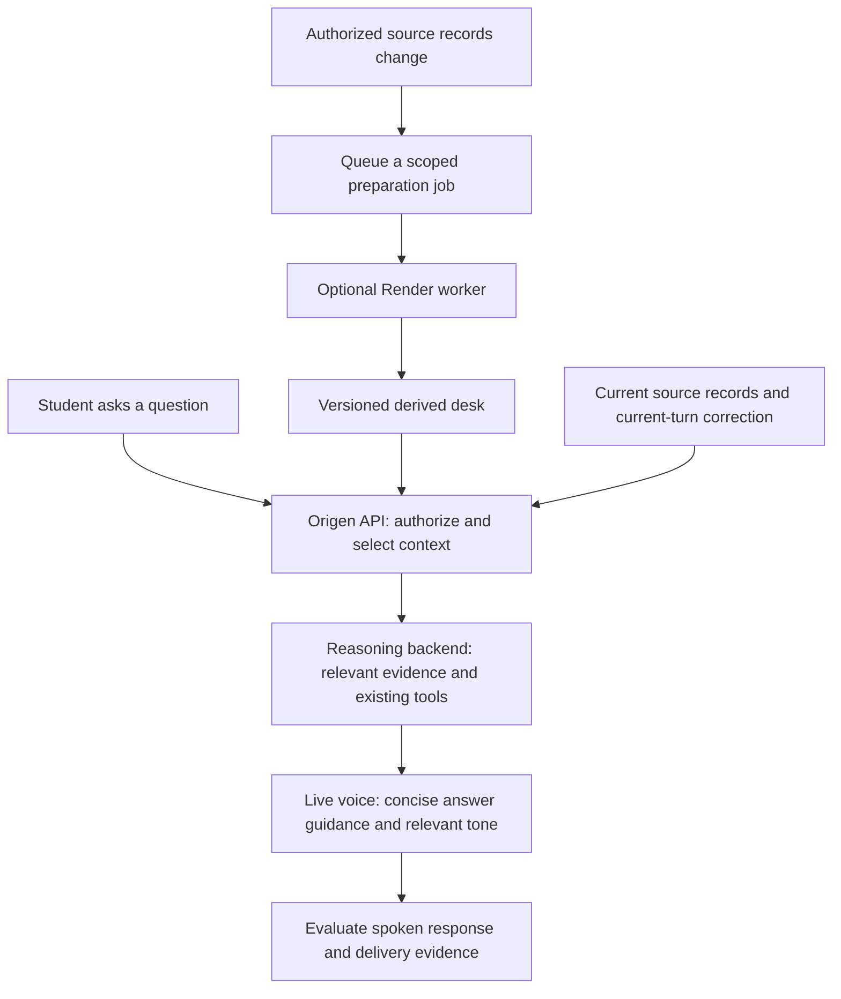

# Origen Conversation Desk

**Status:** Deferred proposal — no worker or product changes authorized or implemented by this review.  
**Prepared:** November 3, 2026  
**Revisit:** November 4, 2026, at 9:00 a.m. Pacific

## The decision to make

Origen should arrive prepared, remember what matters to the current question, and connect student conversations with appropriate coordinator guidance. A student should not have to say, “Catch up on my history,” before receiving a useful answer.

A Conversation Desk would be a small, organized view of relevant information already in Origen. A background worker could prepare and refresh that view ahead of a conversation. The worker would improve preparation time and isolate background work; the selection and delivery design would determine whether the conversation improves.

**Recommendation: improve and measure the current context selection and delivery first. Add a worker only if preparing that context is a measured bottleneck.** Origen already has profile context, history retrieval, teaching references, coordinator guidance, and permission controls. This is an extension of those systems, not a replacement memory system.

The accompanying [backend review](<C:/Users/danie/Documents/ChatGPT/Project Elo-Em/docs/voice-experience/CONTEXT_USE_REVIEW.md>) identifies concrete opportunities that do not require a new service.

## What the student should experience

Consider a fictional student, Riley, who previously explained that they work evenings and are exploring a transfer. A coordinator later suggests comparing course schedules before choosing a next step. Riley returns and asks, “Where should I start?”

An effective response could be:

> “Earlier, you mentioned working evenings. Your coordinator suggested checking how classes would fit around that. We could start there, or talk about what feels most urgent to you today.”

This connects a relevant constraint, attributed human guidance, and the student's choice. It does not assume that Riley accepted the suggestion, completed a task, or still has the same schedule. If the information is old or conflicts with a correction, Origen should clarify naturally.

The objective is useful continuity across college options, transfer planning, applications, financial aid, and next steps. It is not a longer opening speech, a recitation of everything saved, or a financial-aid calculation engine.

## Current approach and proposed addition

| Area | Current local implementation | Proposed desk contribution |
|---|---|---|
| Starting a call | Server assembles profile, selected history, workspace context, and teaching references. Live receives a smaller orientation than the reasoning backend. | Prepare a versioned starting brief before the call, then validate its scope and freshness when used. |
| A new question | Current context and optional recall tools provide information; guide refresh also selects context. | A question-aware selector chooses the relevant facts and guidance before a history-dependent answer. |
| Conversation history | Bounded summaries and keyword retrieval limit how much is supplied. | Organize pointers to useful evidence, with dates, attribution, and unresolved questions. Preserve originals. |
| Coordinator feedback | Existing permission-aware guidance and follow-through mechanisms are available. | Connect a suggestion to the concern it addresses and the student's later response. |
| Teaching style | Published teachings include tone and conversational approach. | Select the appropriate teaching for the current concern and deliver its relevant behavior to the speaking model. |
| Corrections | Existing revision, consent, and scope checks protect updates. | Invalidate stale desk items and prioritize the current correction without silently rewriting source records. |
| Speed | A short-lived, in-process preparation cache already exists. | A worker could prepare expensive derived context outside the live request path, if justified by measurements. |

The proposed per-question selection is valuable even without a worker. A precomputed brief alone cannot know the next thing a student will ask.

## What belongs on the desk

The desk is a private, derived view for one authorized account and one exact student or family scope. It should contain the minimum needed for the current conversation.

| Section | Contents | Boundary |
|---|---|---|
| Who is speaking | Caller, their role, and the confirmed student or family scope. | A parent's name and the student's name are different identities. |
| Starting orientation | Current stage, relevant goal, preferences, and one useful point of continuity. | Do not read a dossier aloud or introduce sensitive details unnecessarily. |
| Current focus | Latest completed user turn, explicitly selected binder item, and any current correction. | In-progress speech and inferred intent are provisional. |
| Relevant evidence | A few source-backed facts or excerpts, each with an ID, revision, date, and attribution. | A summary is not a verbatim quote or independent verification. |
| Open questions | What is unresolved and what information is actually needed to answer now. | Do not collect additional personal details merely to fill fields. |
| Human guidance | Relevant coordinator comments and proposed actions the student is permitted to access. | A coordinator suggestion does not establish student agreement. |
| Student choices | Accepted, deferred, declined, or still-exploring next steps. | Discussion is not acceptance; reported completion is not verified completion. |
| Teaching approach | Published teaching references, tone, explanation approach, and useful follow-up. | Examples are guidance, not scripts or facts about this student. |
| Boundaries | Missing information, conflicts, outdated information, and referral requirements. | Individual eligibility and financial calculations remain with the appropriate office. |

A source item should carry, at minimum: account and scope, source type and ID, source revision, relevant event date, attribution, uncertainty/status, and why it was selected. Generation time and permission-policy version belong on the overall bundle.

Keep relationships explicit where supported: **concern → coordinator suggestion → student choice → later conversation → reported progress**. Do not manufacture a missing link. An assistant's inference should never become a student's decision simply because it appears in a recap.

As an initial experiment, aim for a compact starting orientation, perhaps 600–1,000 tokens, followed by targeted evidence when needed. This is a tuning proposal, not a provider limit or a proven optimum. Privacy and attribution must survive compression.

## How preparation and delivery would work

1. **Prepare when useful.** After sign-in and student selection, prepare only the authorized starting context. Source updates can invalidate the affected scope. Avoid building desks for every student on every login.
2. **Select for the question.** Use the completed user turn and intentional binder selection to choose relevant information. Reuse a fresh bundle when it already covers the question. A greeting or “thank you” does not require another database search.
3. **Check before delivery.** Verify account, scope, content revision, permission state, active session, and turn sequence. An old result must not arrive after a student switch or a new correction.
4. **Reason with evidence.** The reasoning backend receives the selected evidence and existing guarded tools. It determines what can be answered, what needs clarification, and which teaching fits.
5. **Speak naturally.** The voice receives the answer-relevant facts, attribution, uncertainty, and tone. It should not expose internal retrieval instructions or force a coordinator's proposal on the student.
6. **Observe the result.** Record which source references were selected and delivered, then evaluate whether the spoken answer used them appropriately. Delivery alone is not proof of use.

Ordinary factual additions should use the provider's quiet context mechanism where appropriate. Behavioral instructions require more care because they can redirect or interrupt speech. The exact integration needs a prototype against Origen's current managed delegation before implementation. [OpenAI Live delegation documentation](https://developers.openai.com/api/docs/guides/live-delegation)

## What the worker should and should not do

| Worker preparation | Foreground API responsibility |
|---|---|
| Build a bounded, derived brief from authorized source records. | Authenticate the caller and authorize the exact scope. |
| Identify candidate relevant facts and unresolved relationships. | Select information for the current question and validate freshness. |
| Refresh after meaningful source changes; coalesce repeated jobs. | Apply current corrections immediately and prevent stale answers. |
| Prepare expensive recaps or indexes outside the call path. | Deliver context into the active voice session. |
| Emit timing, revision, and outcome metadata. | Enforce consent and permissions for all writes and sharing. |

The worker must not independently publish binder entries, alter sharing, mark a task completed, accept coordinator advice, or overwrite the source history. It must not become an unrestricted reader of every family's records.

A new live transcript need not trigger a large model job on every word. If later authorized, work from finalized turns or meaningful state changes, with debouncing and a strict per-session budget. Immediate corrections belong in the foreground; they must not wait in a queue.

## Render integration, if we later choose it

Render background workers are persistent processes intended to consume queued work, without an inbound web endpoint. The API should remain responsible for authenticated requests and live-session delivery. [Render service types](https://render.com/docs/service-types), [background workers](https://render.com/docs/background-workers)

The repository already has Postgres-backed binder jobs and an API-hosted worker loop. A separate Conversation Desk consumer could reuse that operational pattern. Redis is not automatically required. Keep desk preparation separately scheduled or queued so lengthy binder organization does not delay conversation preparation.

Before deploying a service, specify:

- A job identity based on account, exact scope, content revision, and permission-policy version.
- Idempotent writes to a derived cache, with a rule that older jobs cannot replace newer output.
- Leases, bounded retries, timeouts, concurrency limits, and retry visibility.
- Limited database privileges and the same account/scope protections as the API. Do not assume a background database connection inherits request authorization.
- Cache expiration, correction/revocation invalidation, and deletion behavior covering derived content and queued jobs.
- A fallback that uses an authorized direct read or asks one focused clarification when preparation is unavailable.
- Separate measures for queue delay, preparation time, cache validity, and actual call latency.

There is no deployment configuration or cost commitment in this proposal. Select a service size only after measuring representative job duration, memory, database pressure, and expected concurrency.

## Privacy and freshness requirements

The cache is never the authority for access. Reauthorize both when reading it and immediately before delivering a result. Permission changes and scope changes must invalidate pending work; ordinary age-based expiration is insufficient.

Preserve separation between accounts, between students in a family, and between family-private conversations and student-shared selections. A coordinator can only receive what existing sharing rules allow. Making context more useful for a student's own conversation must not widen coordinator visibility.

Current spoken corrections should override stale context within the conversation while retaining existing consent rules for durable changes. Do not automatically persist a correction simply because it was spoken. Historical evidence should remain inspectable, with superseded items excluded from current advice.

Treat retrieved notes and coordinator comments as reference data. Text inside a saved note cannot authorize an action, override the system's instructions, or change permissions.

## A phased decision, not an implementation commitment

| Phase | Smallest useful change to consider | Evidence required to continue |
|---|---|---|
| 1. Establish a baseline | Trace a question from source selection through backend delivery to the spoken answer. Use fictional cases. | Know whether failures arise in selection, delivery, reasoning, or speaking. |
| 2. Improve current delivery | Make refreshes question-aware; align regular student teaching retrieval with the behavior being tested in admin. | Fewer repeated questions and better use of relevant context without privacy or latency regressions. |
| 3. Evaluate response control | Prototype an app-controlled answer boundary only if managed delegation cannot provide the required guarantees. | Demonstrate reliable per-answer context and cancellation before changing the student integration. |
| 4. Consider the worker | Precompute the same proven brief asynchronously. | Measurable reduction in preparation latency or API load, with freshness and permission checks intact. |
| 5. Expand carefully | Add relationship tracking where it improves real follow-through. | Students and coordinators find it helpful; operational complexity and cost remain justified. |

A worker should be rejected or postponed if retrieval is already fast and the failures are caused by wrong queries, omitted context, unclear instructions, or answers that ignore supplied evidence. Moving those failures to another service would preserve them.

## How to judge success

Use a fixed English/Spanish test set with known source records and expected behavior. Include returning students, parents discussing different students, older but relevant constraints, changed plans, revoked sharing, and optional coordinator suggestions.

Measure the proportion of relevant questions answered using supported history, unnecessary requests to repeat known information, correct attribution, appropriate use of teaching tone, respect for student choices, and time to the first useful spoken answer. Track unsupported recollection and cross-scope disclosure separately; an average quality score must not hide them.

Do not equate a teaching lookup, a matching phrase, or successful audio playback with empathy or understanding. Human listening and source-grounded evaluation are still needed.

**The intended outcome:** Origen remembers the right thing at the right moment, explains it in Daniel's conversational teaching style, and helps the student move forward without taking control away from them.
