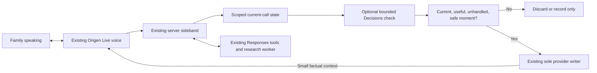

# Origen v1.3: Decisions and conversation-state proposal

Prepared November 7, 2026 (America/Los_Angeles) on `v1.3-decisions-integration`,
from `v1.2` commit `f4073c02e561cfd4dbb997cedc535427e7bd1083`.

**Status: proposal, documentation, and read-only code assessment. No Decisions
integration, runtime prompt change, production setting, or new service is enabled.**

## Recommendation in plain English

Keep the Origen voice and research arrangement that is working. Add a small,
optional Decisions check beside it to notice when a family has asked for a
starting point, a simpler explanation, or a change to an ongoing question.
Give that check a clear view of what has already happened so it does not suggest
repeating something Origen just said.

The voice continues responding normally. It never waits for the check. Most
checks should produce no intervention. When an opportunity is still relevant,
the existing conversation controller may supply one small factual cue at a safe
moment. Origen chooses its own natural wording.

Start with the existing server and worker. A second Render worker is not
necessary for this first integration. Separate classification infrastructure
would become useful if measured concurrency or isolation needs justify it.

This is an engineering recommendation for Origen, not a claim that OpenAI
requires this architecture or guarantees a naturalness improvement.

## Review and evidence

The 30-page Decisions manifest was reviewed in two passes: capabilities first,
then requirements, contracts, and edge cases. Guides and supporting documents
were read in full twice. Generated API references used the previously approved
exact unique-content method, with intact nested-schema rechecks. This is not a
claim that every repeated schema was reread literally. All files were available.

- [Guide coverage and code comparison](decisions/reviews/guides-review.md)
- [API-contract coverage, deduplication method, and limitations](decisions/reviews/contracts-review.md)
- [Supporting guidance and data-handling review](decisions/reviews/support-review.md)
- [Saved Decisions reference](OPENAI_DECISIONS_REFERENCE.md)
- [New official conversation-state library](conversation-state/README.md)

Current official Decisions, voice integration, Live event contracts, and
conversation-state guidance were checked against the saved material. The new
conversation-state collection contains 35 official snapshots with a manifest,
source URLs, hashes, and an offline verifier. Collecting it does not mean every
new snapshot received the Decisions library's two-pass review.

This assessment used local code and documentation. It did not retrieve new
production calls, listen to new audio, or run paid API tests. The proposed
benefits below are hypotheses to evaluate, not measured results.

## What each part does

| Part | What it does for Origen | What this proposal adds |
| --- | --- | --- |
| Live model | Listens and speaks, using the confirmed brief and supplied facts. | Keeps its current voice, intro, relaxed pace, and immediate ordinary replies. |
| Responses | Generates backend answers and runs tool workflows; the research worker also calls Responses. | Remains responsible for reasoning, tools, and researched explanations. |
| Conversation state | Records who the call concerns, the current question, research progress, and what has been supplied or discussed. Much of this already exists in Origen. | A bounded, versioned view of that existing state for the optional observer. |
| Decisions | Classifies supplied evidence into defined categories or probabilities. | Notices narrow conversational opportunities and, later, research refinements. It does not write the spoken answer. |
| Existing research worker | Performs slower official-source research and publishes results. | Continues its existing role. Decisions does not replace it or make source checks instantaneous. |

OpenAI documents predicate, choice, and score questions for Decisions, and
recommends setting thresholds with labeled examples from the application.
Those scores are estimates, not proof of a person's intent or understanding.
[Official Decisions guide](https://developers.openai.com/api/docs/guides/decisions)

## What the code already provides

| Current implementation | Finding | Integration consequence |
| --- | --- | --- |
| [`server/student-live-session.mjs`](../../server/student-live-session.mjs), `studentLiveSession` | `gpt-live-1`, voice `marin`, `store:false`, and managed Responses using `gpt-6-luna`. | Preserve this configuration. Do not replace Responses delegation to add the observer. |
| [`server/voice-control.mjs`](../../server/voice-control.mjs), `voiceControlSession.receive` | One authoritative provider writer; raw sideband events reach the server before adaptation. | Observe here asynchronously; return candidate cues to this owner. |
| [`src/studentLiveChannel.mjs`](../../src/studentLiveChannel.mjs) | Handles transcripts, Responses, scope, brief timing, and research delivery. Unknown native Decisions events have no dedicated handler. | Simply enabling native triggers would be incomplete. Add explicit handling only if that path is selected. |
| Same adapter's generic application-message path | Can become `session.instructions.append`, which can interrupt speech. | Do not send routine Decisions cues through that path. |
| [`src/voiceStartingPoints.mjs`](../../src/voiceStartingPoints.mjs) and [`server/profile-voice.mjs`](../../server/profile-voice.mjs) | Already support explicit requests for starting ideas, at most two options, and one easy question. | Measure missed opportunities to apply these rules; do not claim the capability is entirely new. |
| [`server/voice-opening-brief.mjs`](../../server/voice-opening-brief.mjs) and [`server/voice-preparation.mjs`](../../server/voice-preparation.mjs) | Build and prepare the scoped opening brief. | The research worker is not the brief builder. Keep the intro outside initial Decisions interventions. |
| [`server/voice-research-worker.mjs`](../../server/voice-research-worker.mjs) | Uses standalone Responses for source checks, initial findings, and bounded recovery. | Reuse existing research records, scope checks, and delivery protections. |
| [`server/live-measurements.mjs`](../../server/live-measurements.mjs) | Separates native and application events; existing Responses accounting does not account for Decisions. | Add Decisions-specific diagnostics rather than attributing its cost or delays to research. |

These observations identify integration points, not defects requiring changes
to the working intro. The detailed review files include inspected line numbers.

## Where conversation state fits

OpenAI describes several ways to maintain Responses history: explicit history,
response chaining, and durable Conversations objects. A Conversations object
can persist messages and tool items across sessions or jobs. It does not
automatically read Origen's database, synchronize the Live session, or determine
which student is authorized.
[Official conversation-state guide](https://developers.openai.com/api/docs/guides/conversation-state)

For the initial Decisions integration, use **application-owned state** already
available in Origen. Build a read-only projection, updated from events rather
than an extra summarization call after every utterance:

| State supplied to the observer | Why it matters |
| --- | --- |
| Authenticated call, confirmed student, permission revision, and scope epoch | Reject observations belonging to a previous student or connection. |
| Caller role, active language, and the relevant portion of the authorized brief | Avoid addressing a parent as the student or asking for supplied details. |
| Bounded recent input and output transcript spans, with their source IDs and times | Understand short replies and corrections in context. Keep unfinished speech provisional. |
| Current question and revision; related research job IDs and revisions | Tell a refinement from a new task without resetting everything. |
| Relevant verified findings with year, scenario, limitations, and source IDs | Recognize possible reuse while leaving factual verification to the existing research system. |
| Offered, declined, addressed, and still-open conversational opportunities | Avoid repeating invitations or reviving an abandoned topic. |
| Separate context acknowledgment, transcript, and playback observations | Do not treat generated text as proof that a complete answer was heard. |

No new OpenAI Conversations storage is required for this view. Consider durable
Conversations later only for a concrete standalone Responses continuation need,
with explicit account/student scoping and deletion/retention behavior. It is a
separate storage choice; current Live `store:false` does not establish retention
for a new endpoint. Check each endpoint's current data policy.
[Official data controls](https://developers.openai.com/api/docs/guides/your-data)

If Responses continuation is later added, preserve complete response items and
their supported fields, including applicable phase or encrypted reasoning
items. Do not substitute a plain-text transcript for tool-call state or assume
standalone continuation/compaction settings are supported by managed Live
delegation. That would be a separate, contract-tested change.

## Recommended Decisions connection

| Option | Advantages | Tradeoffs | Recommendation |
| --- | --- | --- | --- |
| Bounded standalone Decisions requests from the existing server | Exact control over input scope, scheduling, replay, timeouts, and spending. | Requires a small request scheduler and explicit correlation. | Start here, observe-only. |
| Native Live transcript triggers alongside Responses | Direct integration and source-event correlation; avoids an application-mediated classification request. | Results can be coalesced/out of order; the documented trigger configuration exposes no cadence, concurrency, or per-call budget setting. | Evaluate later against the same fixtures if it offers a measured advantage. |
| Replace managed Responses delegation with Decisions delegation | Classification can choose actions before an application-run Responses workflow. | Transfers more workflow ownership and changes the working tool architecture. | Not needed for this proposal. |

OpenAI supports both Decisions delegation and separate transcript triggers.
Independent triggers can coexist with the current Responses delegation. These
are different integration choices, not interchangeable settings.
[Official voice integration](https://developers.openai.com/api/docs/guides/decisions-voice),
[Live creation contract](https://developers.openai.com/api/reference/resources/live/methods/create)

For standalone requests, keep at most one evaluation in flight per call and one
coalesced newest pending snapshot. Evaluate meaningful changes, not every text
fragment. Keep the question rubric stable, bound input, apply timeouts and
per-call/account spending limits, and stop when the call closes. A timeout,
refusal, malformed answer, missing event, or uncertain classification produces
no intervention. Never await this path before forwarding audio or ordinary
conversation events.

Reserve a conservative maximum evaluation cost before sending each request.
Keep timed-out or aborted requests reserved until usage is reconciled: client
cancellation does not prove the provider incurred no charge. Do not automatically
retry superseded evaluations; unknown usage must not silently reopen the budget.

Use a small named question set with explicit `none` and `unclear` outcomes.
Validate the answer type and allowed values. Preserve probabilities and
confidence as distinct fields; select thresholds from labeled English and
Spanish cases. Do not translate a classification into a saved student fact,
accepted action, permission, scope selection, or tool authorization.

For any later native experiment, separately handle `decision.event`, its source
event and trigger identity, errors/refusals, usage, and revision changes.
Decision-item updates affect Decisions context, not Live speech context. Do not
invent delegation IDs or assume shared items are synchronized automatically.
[Official primary event contract](https://developers.openai.com/api/reference/resources/live/primary-websocket)

## Proposed implementation phases

| Phase | Work | What the family gains | Checkpoint before proceeding |
| --- | --- | --- | --- |
| **1. State and baseline** | Build the bounded observer view over existing state; define a small classification rubric and labeled EN/ES/mixed-language cases. Add feature flags defaulting off. | Establishes the context needed to avoid repeated questions and stale advice; no call behavior changes yet. | Verify account/student separation, corrections, reconnect gaps, and unchanged intro/audio/tool events with observer disabled. |
| **2. Observe without intervening** | Run standalone Decisions on isolated fixtures, then a separately authorized test-call allowlist. Log what it would suggest and whether Origen already handled it. | Finds specific missed opportunities before exposing families to a new behavior. | Demonstrate useful detection, bounded cost, reliable no-op behavior, and no added blocking dependency. Calibrate by language and caller role. |
| **3. Help people move forward naturally** | Permit narrow cues for an explicit request to get started, understand an explanation, or identify a next step. Use known stage/interests, allow a decline, and suppress anything already addressed. | More consistent help for families who do not know which question to ask, without an interview or repeated menu. | Paired listening tests must show useful assistance without worse pacing, interruption, repetition, or first-answer delay. Compare against a simpler prompt-only change too. |
| **4. Improve research continuity** | Add advisory categories for a refinement, added comparison, correction, already-covered question, or missing evidence. Feed the existing guarded research controller. | Growing questions can remain connected; existing results are reused and new checks stay focused. | Classification alone cannot cancel/restart work, assert a fact is verified, or block an explicit research request. Test partial and late results across topics. |
| **5. Validate and release gradually** | Run long bilingual calls and fault tests; use a small allowlist and separate observe/intervene switches. Expand only after review. | Improvements demonstrated in actual conversation, with a quick return to baseline if they regress. | Confirm speech and research outcomes separately; no production activation until authorized. |

Each phase is separately reviewable. Phase 3 is the first intended user-visible
change. Neither a second worker nor multi-agent orchestration is a prerequisite.
Research expansions should follow demonstrated conversational benefit rather
than being bundled into the first release.

## How a helpful cue reaches the voice

In observe-only mode, the path ends at diagnostics. In a later intervention
trial, recheck current authorization, permission revision, connection epoch,
scope, question revision, existing answer, declined offers, mandatory workflows,
and current speech at delivery time. Revocation or disconnect drops pending
cues; reconnect does not replay them. If Origen already
responded usefully or the opportunity passed, discard the cue. Do not hold an
answer open waiting for it.

A candidate factual cue might be: “The caller explicitly asked where to begin.
The confirmed brief places the student in high school. No starting option has
yet been discussed in this exchange.” It is not a script or a command to stop
speaking. Send only the minimum relevant facts through the existing controlled
delivery path, ordinarily as quiet context. Keep it well below the documented
500-token append limit and use `delegation_id:null` for general context.

`thinking.append` does not request immediate speech, but it can influence later
speech; it is not a guarantee against disruption. `commentary.append` asks for
spoken content, and `instructions.append` can interrupt. Therefore ordinary
Decisions cues must not force either a new announcement or an interrupting
instruction. Confirm their effect with real audio.
[Official Live delegation/update guidance](https://developers.openai.com/api/docs/guides/live-delegation)

## Illustrative conversations, not test results

**Parent:** “Nobody in our family has gone to college. I don't know where to begin.”

*(Origen can answer immediately. The observer checks the explicit request for a
starting point. It does not label the family as incapable or infer confusion
from language or first-generation status.)*

**Origen:** “That's okay—we can take this one step at a time. Would it help to
start with what Aiden might enjoy studying, or how paying for college works?”

*(If Origen already offered this help, the observer supplies nothing.)*

**Parent:** “How paying works. I don't want him taking on a lot of debt.”

**Origen:** “That makes sense. We can start with help that doesn't have to be
repaid, then talk about borrowing if we need to.”

*(A general explanation continues without research. A later question about a
specific school's current costs follows the existing official-source path.)*

**Familia:** “No sé por dónde empezar. Todo esto es nuevo para nosotros.”

**Origen:** “Claro, podemos ir paso a paso. ¿Les ayudaría más hablar de qué le
gustaría estudiar a Aiden, o de cómo pagar la universidad?”

**Familia:** “Primero queremos entender los costos.”

**Origen:** “Claro. El costo incluye más que las clases; también puede incluir
vivienda, comida y transporte. Podemos ir viendo cada parte.”

These are examples of tone and scope, not mandatory wording. Decisions should
not generate the lines or make every conversation follow this sequence. A family
asking a specific question receives that answer first.

## Diagnostics and acceptance evidence

Record a bounded diagnostic event for each evaluation with call ID, authorized
scope revision, source transcript IDs/span, question version, model, provider
request ID, duration, usage, result type, and candidate category. Keep protected
transcript text out of ordinary service logs. Store actual intervention and
suppression reason separately: stale scope, newer question, already handled,
declined, uncertain, no safe moment, timeout, closed call, or budget limit.

Keep these observations distinct: classification returned; cue eligible;
context sent; context acknowledged; related words observed in the output
transcript; available playback evidence. None alone proves a complete answer
was heard or understood. Correlate with the existing research job and delivery
records when applicable. Specify retention and deletion for any new diagnostic
records rather than relying on ephemeral Render logs.

Before activation:

- Test brief acknowledgments, unfinished sentences, genuine interruptions,
  corrections, already-answered questions, declined help, student changes,
  reconnects, delayed/out-of-order results, and research arriving mid-answer.
- Include high-school exploration, applications, reading college messages,
  paying for college, campus support, adult learners, and family questions;
  use English, Spanish, and mixed language. Do not limit evaluation to transfers.
- Evaluate classification precision and recall separately from conversational
  benefit. Use held-out labeled cases and report sample sizes and uncertainty.
  Favor high precision for optional interventions; set numeric thresholds from
  evidence rather than choosing an arbitrary confidence value.
- Require zero cross-student cue use, unauthorized actions, and stale-result
  application in the fault suite. Verify no new writes to student or
  network-effects records based on classification alone.
- Compare useful audible response time (p50/p95), repetition, unwanted
  interruptions, missed help requests, research reuse, and per-call cost.
  Human listening review is required for warmth and naturalness.
- Compare current baseline, a minimal prompt-only alternative, and the
  Decisions-assisted variant. Keep voice and other settings stable. Keep
  Decisions only if it adds enough benefit to justify complexity and cost.

No naturalness percentage or speed improvement can be established from this
documentation review. The most credible expected benefit is **more consistent
recognition of helpful conversational opportunities and better continuity of
changing questions**, while preserving the voice behavior already working.

## Scope for the first implementation request

Begin with phases 1 and 2 on this branch, using isolated fictional data. The
observer must emit no speech/context/tool changes. Paid Decisions or voice
testing needs an explicitly approved current budget. Broader Responses-library
preparation required by `AGENTS.md` still applies before runtime changes; this
proposal's Decisions review is not a substitute for it.

No code implementing those phases, migration, model call, commit, push, or
deployment is included in this proposal.
