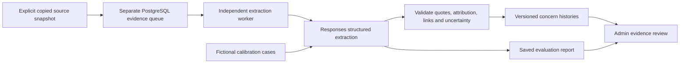

# v1.2 — Network Effect Architecture, steps 1–3

Built on the v1.1 baseline. This branch adds an evidence extraction and review path for first-generation college students and their families. It is separate from the live conversation and all information currently supplied to it.

## What changed

| Step | Before | v1.2 implementation | Why it matters |
| --- | --- | --- | --- |
| 1. Calibrate real extraction | The local demo replayed prepared fictional labels. | A Responses test runner with 60 fictional English, Spanish and mixed-language cases, a held-out partition, per-case evidence comparisons, timing and persistent spending limits. | Two real-model passes now expose mistakes before the evidence is trusted. See [calibration findings](CALIBRATION_RESULTS_V1_2.md); passing structure checks is not an accuracy claim. |
| 2. Reach it through Admin | The research review page was a standalone local tool. | **Admin → Network Effect Architecture**, with Evidence, Review, Evaluations and Processing sections. | Authorized reviewers can compare an observation with the original source, review corrections, and inspect model tests in the existing admin interface. |
| 3. Prepare the backend | The isolated workspace used SQLite. | A separate PostgreSQL schema, repository, queue and worker; explicit copied-source import; restricted database roles; optional standalone Render configuration. | Evidence can survive restarts and be processed independently. Later algorithms will have structured histories across topics without adding work to a voice turn. |

No automatic collection, cross-user guidance publication or live injection is enabled. The worker does not read operational student tables. Sources must be supplied explicitly as authorized copied snapshots. No student forms or conversational questions were added.

## Data flow



There is no outgoing connection from this path to the live model, opening brief, binder, memory retrieval, teaching library, or research delivery. The current voice worker and `render.yaml` are unchanged.

## Local preview

The isolated preview uses the actual Admin component and API handler with a fictional staff identity and an embedded PostgreSQL engine (PGlite). It does not load application environment files or start the voice API. It binds to loopback and blocks non-admin API routes and external browser connections.

```powershell
npm install --prefix research/network-effects/.local/pg-test-runtime --no-save @electric-sql/pglite
node research/network-effects/admin-preview.mjs
```

Open <http://127.0.0.1:8792/#admin>. This preview contains 15 fictional sources, 10 concern histories and 26 current observations. Its prepared extraction results demonstrate the interface, not model accuracy. The preview is disposable and is not a login mechanism for the deployed application.

An actual calibration report can be loaded with `--report <local-report.json>`. `--read-only` exercises review restrictions; `--disabled` exercises the feature-off state. Read [calibration.md](calibration.md) for the paid runner, cost accounting and review rubric. Do not substitute a new budget ID to evade an existing spending cap.

## PostgreSQL installation — explicit, not applied to production

Use a separate database for this workload when possible. No automatic application migration references these files. Provide credentials through environment variables; commands deliberately do not load `.env` or fall back to `DATABASE_URL`.

```powershell
# Requires NETWORK_EFFECTS_MIGRATION_DATABASE_URL, supplied separately.
node scripts/network-effects.mjs migrate
node scripts/network-effects.mjs grant-roles
```

The role script creates `origen_network_worker` and `origen_network_admin` without login passwords. An operator must configure their login credentials separately before using network connections. Do not grant either role to an operational application role. The migration owner is never a runtime credential.

The worker may change only evidence-schema data. The admin role can read that schema, append review records and rebuild its derived concern projection; it cannot change source records. Runtime checks reject unexpected role names, powerful role membership, schema creation privileges, and write privileges on other application tables. Database permissions enforce access even after a connection has been pooled.

## Explicit import and independent worker

An input file contains `{ "sources": [ ... ] }`, using the source contract in [README.md](README.md). This differs from the original SQLite demo's `{records:[{source,extraction}]}` format: the PostgreSQL import queues sources for extraction instead of accepting a supplied extraction.

```powershell
# Requires NETWORK_EFFECTS_DATABASE_URL for the restricted worker role.
node scripts/network-effects.mjs import copied-sources.json
node scripts/network-effects.mjs status
node scripts/network-effects.mjs import-evaluation saved-calibration-report.json
node scripts/network-effects.mjs worker
```

Input shape is checked before connecting. Each source is committed atomically; a bulk snapshot can partially complete if a later source conflicts with a previously saved version. Unchanged replay is idempotent, so inspect the failure and resume the same snapshot. The importer does not silently overwrite changed evidence or load account data itself.

The worker requires all of:

| Variable | Purpose |
| --- | --- |
| `NETWORK_EFFECTS_WORKER_ENABLED=true` | Explicitly starts job processing; otherwise exits without connecting. |
| `NETWORK_EFFECTS_DATABASE_URL` | Restricted worker credential for the evidence database. |
| `NETWORK_EFFECTS_OPENAI_API_KEY` | Explicit extraction API credential, separate from voice configuration. |
| `NETWORK_EFFECTS_BUDGET_ID` | Durable identity for an authorized spending cap. Reuse on restart. |
| `NETWORK_EFFECTS_BUDGET_USD` | Total cap for that budget identity; changing an existing cap is rejected. |
| `NETWORK_EFFECTS_DATABASE_TLS_MODE`, `NETWORK_EFFECTS_DATABASE_SSL_CA` | Optional connection settings; production certificate verification remains enabled by default. |

One worker processes one job at a time. A lease protects each job. Source changes invalidate stale completion. There is one paid attempt per queued job, a 45-second request deadline, no automatic provider retries and a conservative reservation before every request. Confirmed usage settles the reservation; unknown usage retains it. An exhausted budget stops work. Shutdown cancels the active request and closes the database connection. No source text or provider error bodies enter process logs.

`render.network-effects-worker.yaml` is an optional separate Blueprint, not applied. Its automatic deployment and processing flags are off. It has no automatic migration command, database creation, or link to the existing voice worker. Before any future deployment, provision the isolated database/roles, supply the explicit credentials and budget, enable processing deliberately, and validate the full installation. The disabled command exits; do not deploy that disabled template expecting an active worker.

## Existing Admin integration

Normal authentication, staff revocation checks and access audit remain mandatory. The new capabilities are:

- `read:network-effects` for evidence, source inspection, jobs and evaluations.
- `write:network-effects-review`, plus the read capability and a recent login, for review decisions.

The API additionally requires `NETWORK_EFFECTS_ENABLED=true` and `NETWORK_EFFECTS_ADMIN_DATABASE_URL`, using the restricted admin role. Defaults remain off; no production settings or permissions were changed. The API does not expose provider execution, import, deletion or publication actions. Review decisions are tied to the exact evidence revision and fail if the evidence has since changed.

## Validation and limits

Run:

```powershell
node --test research/network-effects/*.test.mjs server/network-effects/*.test.mjs server/admin.test.mjs server/staff-access.test.mjs
npm run build
```

The repository tests exercise PostgreSQL SQL through PGlite, including permissions and transactions, with fictional data and mocked provider responses. This verifies the database behavior locally, but is not a multi-process server PostgreSQL contention test or a production load benchmark. A staging PostgreSQL rehearsal remains appropriate before deployment.

Schema validity and exact supporting quotations do not establish correct interpretation. Calibration reports keep the source, candidate, authored expectation and review flags together. A fluent reviewer must check uncertainty, attribution, important omissions and the meaning of sequential corrections. The release gate remains `human_review_required`.

Real-model calibration has now run under the approved $5 cap: 120 requests across two unchanged passes, approximately two cents estimated cost. [The findings](CALIBRATION_RESULTS_V1_2.md) identify corrections, metadata and outcome-classification problems that need work before trusting automatic statistics. Later automatic collection would need a separate design for source permissions, deletion propagation and organization boundaries. None of that is silently enabled by this branch.

## Guidance used

Read the repository's [Responses reference](../../docs/voice-experience/OPENAI_RESPONSES_REFERENCE.md) and current official guidance before implementing provider behavior. Strict [Structured Outputs](https://developers.openai.com/api/docs/guides/structured-outputs) supplies the shape; application validation and task-specific [evaluations](https://developers.openai.com/api/docs/guides/evaluation-best-practices) address whether the extraction is useful and supported. The separate worker template follows the current [Render Blueprint specification](https://render.com/docs/blueprint-spec) and [shutdown lifecycle](https://render.com/docs/deploys). These references informed this implementation; they are not a claim of provider review or endorsement.
# Correction and extraction follow-up

See [v1.2 fixes and retest](V1_2_FIXES_AND_RETEST.md) for the correction safeguards,
compact provider schema, final real-model tests, remaining semantic limitations
and budget. The isolated Admin preview at port 8794 now uses actual fictional
model outputs, with no voice or production connection.
